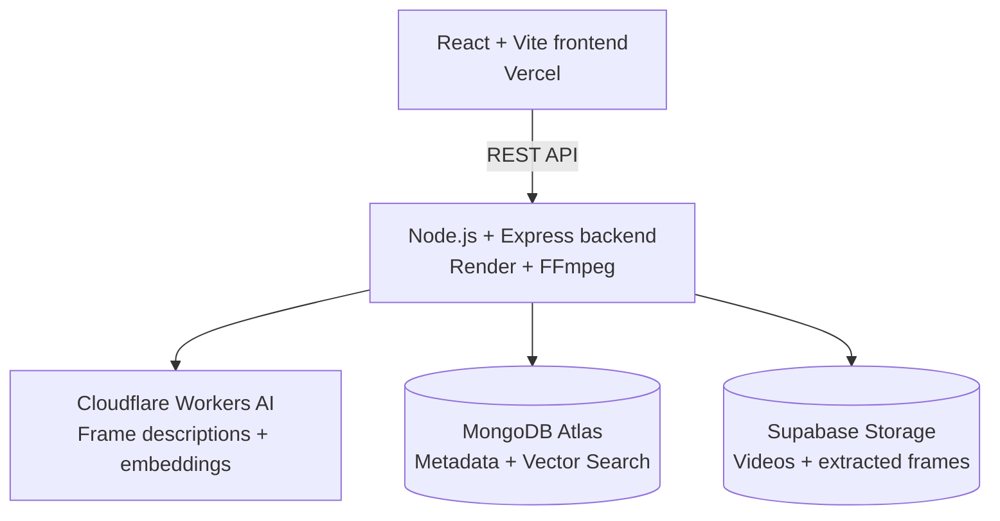

# Intelligent Semantic Video Search & Content Indexing Engine

Search inside videos using natural-language queries. This full-stack application extracts frames from uploaded videos, generates AI descriptions and text embeddings, and returns relevant scenes with timestamps so you can jump directly to the moment you need.

**Live demo:** [intelligent-video-search-frontend.vercel.app](https://intelligent-video-search-frontend.vercel.app/)

**Backend health check:** [intelligent-video-search-api.onrender.com/api/health](https://intelligent-video-search-api.onrender.com/api/health)

## Features

- Upload videos through a React web interface.
- Extract frames with FFmpeg at regular intervals.
- Generate frame descriptions with Cloudflare Workers AI.
- Generate text embeddings with Cloudflare Workers AI EmbeddingGemma.
- Store video and frame metadata in MongoDB Atlas.
- Find scenes using hybrid semantic vector search and keyword search.
- View indexing progress and processing status in the video library.
- Jump to a search result's timestamp and start playback in the built-in video player.
- Resume unfinished processing, retain completed frame work, and remove a video's associated cloud assets.
- Store videos and extracted frames in a private Supabase Storage bucket.

## Architecture



### Video indexing flow

1. A user uploads a video through the frontend.
2. The Express API saves the upload temporarily and stores the original video in Supabase Storage.
3. FFmpeg extracts frames at regular intervals.
4. Cloudflare Workers AI generates a description for each frame; Cloudflare's EmbeddingGemma model turns the descriptions into vectors.
5. Frame timestamps, descriptions, embeddings, and storage references are saved in MongoDB Atlas.
6. A natural-language query is embedded and matched against the vector index. Keyword results are combined with semantic results to improve retrieval.
7. The user selects a result and the video player seeks to its timestamp.

## Tech stack

| Area | Technologies |
|---|---|
| Frontend | React, Vite, Tailwind CSS |
| Backend | Node.js, Express.js |
| Video processing | FFmpeg |
| Vision descriptions | Cloudflare Workers AI (`@cf/llava-hf/llava-1.5-7b-hf`) |
| Text embeddings | Cloudflare Workers AI (`@cf/google/embeddinggemma-300m`) |
| Database and retrieval | MongoDB Atlas, MongoDB Vector Search, MongoDB text search |
| Object storage | Supabase Storage |
| Deployment | Vercel (frontend), Render (backend) |

Ollama is **not required**. Both frame descriptions and embeddings use Cloudflare Workers AI.

## Live deployment

- **Frontend:** https://intelligent-video-search-frontend.vercel.app/
- **Backend health endpoint:** https://intelligent-video-search-api.onrender.com/api/health

The backend is hosted on Render's free service, which may sleep after inactivity and take a little time to respond to the first request. The frontend and backend are deployed separately.

## Run locally

### Prerequisites

- Node.js 22 or later and npm
- FFmpeg installed and available on your system `PATH`
- A MongoDB Atlas database
- A Supabase project with a **private** Storage bucket (default bucket name: `video-assets`)
- A Cloudflare account with access to Workers AI and an API token

Verify FFmpeg is available by running:

```bash
ffmpeg -version
```

### 1. Clone the repository

```bash
git clone https://github.com/yadnesh155/intelligent-video-search.git
cd intelligent-video-search
```

### 2. Configure the backend

Install backend dependencies:

```bash
cd backend
npm install
```

Create a file named `backend/.env` with the following values. Replace the placeholders with your own credentials; **never commit this file or share its secrets**.

```env
PORT=5000
MONGO_URI=your_mongodb_atlas_connection_string

SUPABASE_URL=https://your-project-ref.supabase.co
SUPABASE_SECRET_KEY=your_supabase_secret_key
SUPABASE_BUCKET=video-assets

CLOUDFLARE_ACCOUNT_ID=your_cloudflare_account_id
CLOUDFLARE_API_TOKEN=your_cloudflare_api_token

# Optional: these are the defaults used by the application.
CLOUDFLARE_VISION_MODEL=@cf/llava-hf/llava-1.5-7b-hf
CLOUDFLARE_EMBEDDING_MODEL=@cf/google/embeddinggemma-300m
```

Start the API:

```bash
npm start
```

The backend health endpoint should return JSON at [http://localhost:5000/api/health](http://localhost:5000/api/health).

### 3. Configure the MongoDB Vector Search index

In MongoDB Atlas, create a Vector Search index on the `frames` collection using the index name `frame_vector_index`. Configure the `embedding` field as a vector with **768 dimensions** and **cosine** similarity.

Example index definition for the Atlas Vector Search editor:

```json
{
  "fields": [
    {
      "type": "vector",
      "path": "embedding",
      "numDimensions": 768,
      "similarity": "cosine"
    }
  ]
}
```

The application also uses MongoDB text search on frame descriptions and keywords. The Mongoose schema defines that text index.

### 4. Configure and run the frontend

Open a second terminal from the repository root:

```bash
cd frontend
npm install
```

Create `frontend/.env`:

```env
VITE_API_URL=http://localhost:5000
```

Start Vite:

```bash
npm run dev
```

Open the local URL printed by Vite (usually `http://localhost:5173`).

## Environment variables

| Variable | Used by | Required | Description |
|---|---|---|---|
| `PORT` | Backend | No | API port; defaults to `5000` locally. The hosting platform provides this in deployment. |
| `MONGO_URI` | Backend | Yes | MongoDB Atlas connection string. |
| `SUPABASE_URL` | Backend | Yes | Supabase project URL. |
| `SUPABASE_SECRET_KEY` | Backend | Yes | Private server-side Supabase key. Never expose it in frontend variables. |
| `SUPABASE_BUCKET` | Backend | No | Storage bucket name; defaults to `video-assets`. |
| `CLOUDFLARE_ACCOUNT_ID` | Backend | Yes | Cloudflare account ID used for Workers AI requests. |
| `CLOUDFLARE_API_TOKEN` | Backend | Yes | Server-side Cloudflare API token. Keep it secret. |
| `CLOUDFLARE_VISION_MODEL` | Backend | No | Defaults to `@cf/llava-hf/llava-1.5-7b-hf`. |
| `CLOUDFLARE_EMBEDDING_MODEL` | Backend | No | Defaults to `@cf/google/embeddinggemma-300m`. |
| `VITE_API_URL` | Frontend | Yes | Base URL of the backend API, with no trailing slash. |

The current upload limit is configured to stay below 50 MB to fit the project's Supabase Storage setup. Cloudflare usage and provider quotas may apply.

## Deployment notes

### Backend on Render

- Root directory: `backend`
- Runtime: Docker
- Dockerfile path: `Dockerfile`
- Docker context directory: `.` (the `backend` directory)
- Set the backend environment variables listed above in Render's environment settings.

The Dockerfile installs FFmpeg and uses Node.js 22. Video files and extracted frames are stored in Supabase rather than relying on Render's temporary local filesystem.

### Frontend on Vercel

- Root directory: `frontend`
- Framework preset: Vite
- Build command: `npm run build`
- Output directory: `dist`
- Set `VITE_API_URL` to `https://intelligent-video-search-api.onrender.com` for the deployed frontend.

Do not put MongoDB, Supabase, or Cloudflare secrets in Vercel's frontend environment variables. Variables prefixed with `VITE_` are included in the browser bundle and should not contain secrets.

## Security notes

- Keep `.env` files out of Git and never put API keys in frontend code.
- Keep the Supabase Storage bucket private; the backend generates signed URLs for playback.
- Use restricted credentials and network access rules for MongoDB Atlas and Cloudflare.

## Repository structure

```text
intelligent-video-search/
├── backend/
│   ├── config/          # Database connection
│   ├── controllers/     # API request handlers
│   ├── middleware/      # Upload and error handling
│   ├── models/          # Video and frame schemas
│   ├── routes/          # API routes
│   ├── services/
│   │   ├── ai/          # Cloudflare description and embedding services
│   │   ├── search/      # Hybrid search
│   │   ├── storage/     # Supabase Storage helpers
│   │   └── video/       # FFmpeg and indexing pipeline
│   ├── utils/           # Upload cleanup and helpers
│   ├── Dockerfile
│   └── server.js
├── frontend/
│   └── src/             # React application
└── README.md
```

## License

No license is currently specified. Add a `LICENSE` file if you want to grant others permission to reuse or modify this project.
